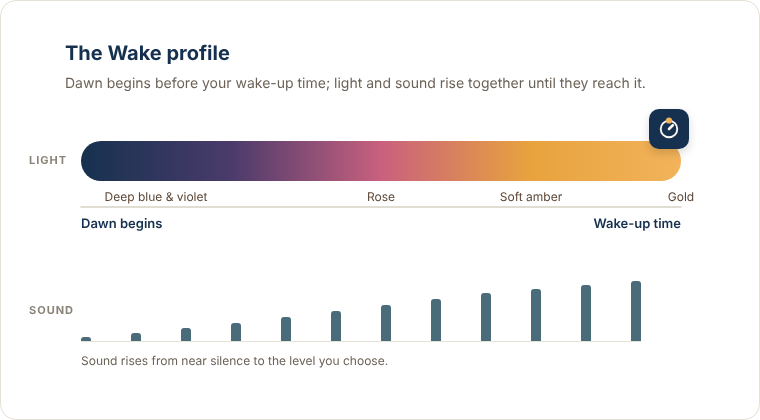

# NaturaWake user guide

NaturaWake is for Android 8 and later.

1. [What NaturaWake does](#what-naturawake-does)
2. [First launch and the free trial](#first-launch-and-the-free-trial)
3. [Setting an alarm](#setting-an-alarm)
4. [The Wake profile](#the-wake-profile)
5. [Adding a Philips Hue lamp (Bluetooth)](#adding-a-philips-hue-lamp-bluetooth)
6. [Adding a WiZ lamp](#adding-a-wiz-lamp)
7. [Tips for a reliable wake-up](#tips-for-a-reliable-wake-up)
8. [Troubleshooting](#troubleshooting)

## What NaturaWake does

Before your wake-up time begins a **dawn**. Your lamps brighten slowly from deep
blue and violet, through rose and soft amber, to a gentle gold. At the same time
a natural sound (birdsong, a stream, rain) rises from near silence. At the
wake-up time the sound reaches the level you chose and, if you want, the phone's
own alarm sound takes over.

You choose the wake-up time. The light imitates the colours of a dawn; it does
not follow the real sunrise.

The sound is the guarantee. It is played by the phone itself and needs neither
Wi-Fi nor Bluetooth. The lamps are an addition: if one cannot be reached, the
dawn goes on without it.

## First launch and the free trial

The first time you open the app, a short walkthrough offers three steps. You can
skip any of them and come back later.

1. **Notifications.** The alarm rings without them, but its Dismiss button and
   the "Light on" notice stay hidden.
2. **A lamp.** See [Hue](#adding-a-philips-hue-lamp-bluetooth) and
   [WiZ](#adding-a-wiz-lamp) below. Without a lamp, the alarm is sound only.
3. **A short dawn.** Your lamps rise from deep blue to warm gold in 40 seconds,
   so you can see the effect. It does not change your alarms.

NaturaWake is free for **30 days**. The Alarms screen shows how many days are
left.

## Setting an alarm

On the Alarms screen, tap **+** to add an alarm. Choose the wake-up time and the
days it repeats. With no day chosen, it rings once. You can have several alarms
and switch each on or off.

You can dismiss an alarm at any time. There is no snooze.

## The Wake profile

One profile, shared by all your alarms, sets how the dawn behaves:

- **Dawn begins** 5 to 60 minutes before wake-up. A natural dawn lasts about 20
  to 30 minutes.
- **Ambience during dawn:** Gentle Rain, Quiet Stream, Leaves in the Wind, Forest
  Ambience or Songbirds, or off.
- **Sound at wake-up:** the level the sound reaches.
- **Phone's alarm sound at wake-up:** the phone's own alarm sound, set in
  Android's Settings.
- **Light at wake-up:** the brightness the lamps reach.
- **Rings for up to** 1 to 60 minutes, then the alarm stops by itself.
- **Keep the light on after the alarm:** the lamps stay lit for a time you
  choose, then fade out.

## Adding a Philips Hue lamp (Bluetooth)

NaturaWake controls a Hue lamp directly over Bluetooth, with no Hue Bridge. It
works with Hue White and Color Ambiance bulbs. A white-only bulb cannot show the
blue and violet of the early dawn.

A lamp that is already set up in the Hue app does not accept a second
connection until you open a short pairing window:

1. In the Hue app, open **Settings, Voice Assistants, Amazon Alexa** (or Google
   Home), then tap **Make Discoverable**.
2. Close the Hue app completely: long press its icon, **App info, Force stop**.
   While it is open it holds the lamp.
3. In NaturaWake, open **Lamps**, choose **Add a lamp** and **Philips Hue**, and
   search. Android asks you to pair: tap **Pair**.

Your Hue app keeps working afterwards. Keep the lamp switched on at its wall
switch, and near the phone.

## Adding a WiZ lamp

A WiZ lamp is controlled over your home Wi-Fi. No cloud account is used by
NaturaWake.

1. Set the lamp up once in the WiZ app, on your home Wi-Fi.
2. In the WiZ app, turn on **Allow local communication** and **Allow all
   controls**. Without them the lamp answers but ignores commands.
3. Keep the lamp switched on, then search in NaturaWake.

WiZ lamps only work on a **2.4 GHz** Wi-Fi network. The phone must be on the same
network as the lamp. Some routers give both bands one name and put the phone on
5 GHz, where the lamp cannot be found. If the lamp is not found, give the 2.4 GHz
band its own name, or turn 5 GHz off for the moment you search.

## Tips for a reliable wake-up

- **Overnight, keep these on** (the sound does not need them): for a WiZ lamp,
  Wi-Fi on the same network as the lamp; for a Hue lamp, Bluetooth, with the lamp
  near the phone. Airplane mode switches both off.
- **Close the Hue app before bed** if you use a Hue lamp. If it stays open in the
  background it can keep hold of the lamp all night, and NaturaWake cannot
  connect to it. NaturaWake reminds you when an alarm is set with a Hue lamp.
- **A strong signal matters.** A lamp at the edge of your Wi-Fi may go offline.
  The Lamps screen shows whether each lamp was reached at the last dawn.
- **Exact alarms (Android 12):** if NaturaWake shows "Exact alarms are switched
  off", tap **Allow**. The alarm still rings on time without it, but its backup
  alarm may come a few minutes late.
- **Plug the phone in** for the night if its battery is low.

## Troubleshooting

**The lamp does not rise at dawn, but the sound plays.**
Open Lamps and read the status under the lamp. "Not reached at the last dawn"
means the phone could not talk to it. Check the points in the tips above: the
phone's Wi-Fi or Bluetooth, the distance, and the Hue app.

**"The Hue app is connected to this bulb."**
The Hue app is holding the lamp. Force stop it, switch the lamp off and on at its
switch, and try again. If it still does not connect, switch the phone's Bluetooth
off and on.

**NaturaWake does not find my WiZ lamp.**
Check that the phone is on the lamp's 2.4 GHz network, and that the two WiZ
settings above are on.

**A WiZ lamp answers but does not change.**
"Allow local communication" and "Allow all controls" are not both on in the WiZ
app.

**The alarm rang with a plain sound and no dawn.**
If the app's dawn cannot start, a fallback rings the phone's alarm sound at the
wake-up time. The wake-up is never skipped.
